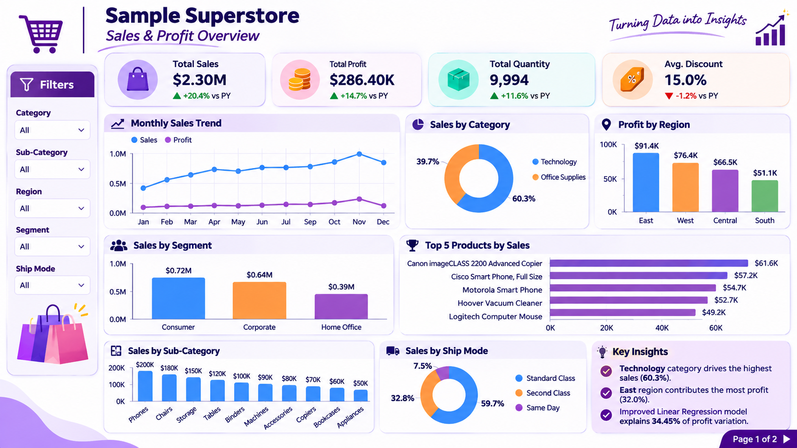
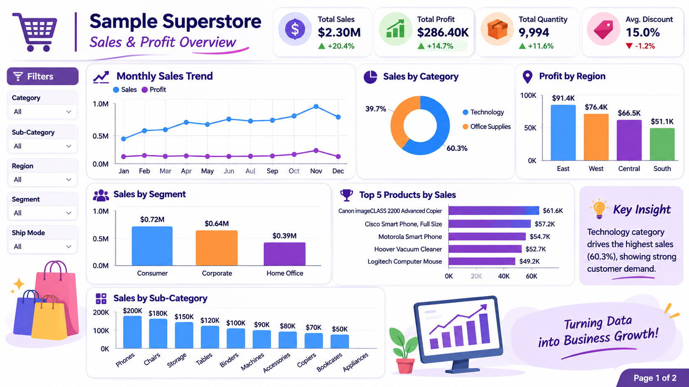
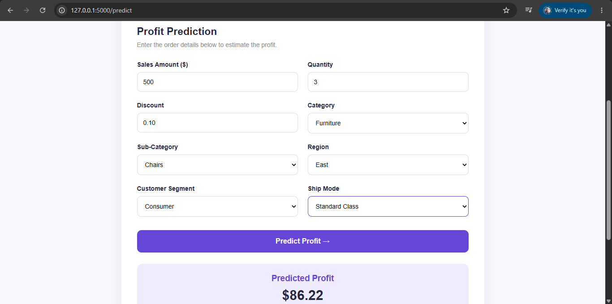

# Sales & Profit Analysis and Prediction Using Linear Regression

## Project Overview
This project focuses on analyzing sales and profit data using SQL and Python, building a Linear Regression model to predict profit, and developing a Flask-based web application for profit prediction.

## Dataset
- Dataset: Sample Superstore
- Total Records: 9,994
- Total Columns: 21

## Tools & Technologies
- **SQL:** MySQL
- **Python:** Pandas, NumPy, Matplotlib, Seaborn, Scikit-learn
- **Machine Learning:** Linear Regression
- **Web Development:** Flask, HTML, CSS
- **Model Storage:** Joblib

## Project Workflow

### 1. SQL Analysis
Performed 20 SQL queries to analyze sales, profit, customers, products, categories, regions, and shipping modes.

### 2. Python Analysis
- Completed 10 data analysis questions.
- Created 10 data visualizations.
- Explored sales, profit, customer segments, categories, and regional performance.

### 3. Machine Learning – Profit Prediction
- Built a baseline model and Linear Regression models.
- Applied feature engineering to improve model performance.
- Evaluated models using MAE, RMSE, and R² Score.

**Best Model Results:**
- MAE: 40.9177
- RMSE: 178.2728
- R² Score: 0.3445

### 4. Dashboard Design Preview
Created visual mockups to demonstrate a possible Power BI dashboard layout for sales and profit analysis.

**Note:** These are dashboard design mockups, not interactive Power BI reports.





### 5. Web Application
Developed a Flask-based web application that accepts order details and displays the model's predicted profit.



## Project Structure
```text
Sales_Profit_Analysis/
├── powerbi/
├── python/
├── sql/
└── website/
    └── templates/
```

## Conclusion
This project demonstrates an end-to-end data analysis workflow, from SQL querying and Python-based exploration to Linear Regression modelling and a Flask-based prediction application.

## Author
Baumika Ramanathan